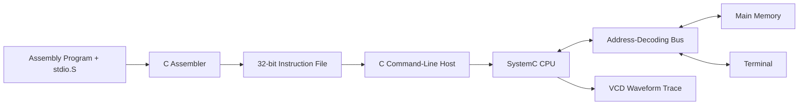

# TinyRISC

TinyRISC is a 32-bit CPU simulator with memory-mapped terminal I/O, a custom assembler, and an assembly standard library. Built with C, C++14, SystemC, and assembly, the project connects low-level software to a simulated hardware datapath: assembly programs are translated into machine instructions, loaded into memory, and executed by a modular SystemC CPU.

## Technical Highlights

- **Modular CPU simulation** with a control unit, ALU, register file, program counter, memory, and multiplexers connected through SystemC signals.
- **Memory-mapped terminal I/O** with address decoding, configurable access latency, and ready/completion signaling.
- **Custom instruction set** inspired by RISC-V, including `jal` for function-call-style control flow and `li` for loading immediate values.
- **Assembler and library support** with label resolution, relative branches, and source-file concatenation for reusable assembly routines.
- **Assembly I/O library** providing `print`, `read`, and `print_optimized` for null-terminated strings.
- **Performance exploration** reducing data loads by approximately 75% and simulated cycles by approximately 9.5% for a 1,024-character output test.
- **Simulation tooling** with CLI configuration, terminal output capture, execution counters, and optional VCD waveform tracing.

## Tech Stack

| Area | Technology |
| --- | --- |
| CPU simulation | C++14, SystemC |
| Host program | C |
| Assembler | C |
| Programs and standard library | Assembly |
| Build system | GNU Make |
| Waveform tracing | VCD |

## My Contribution

My work focused on extending and integrating the CPU: implementing terminal input/output, designing the bus and its signal routing, adding CPU support for `jal` and `li`, and connecting the SystemC simulation to the C host program.

This was a team project developed on top of an existing TinyRISC CPU and assembler baseline. Other team members focused on assembler labels, function calls, library integration, the host program, and the assembly I/O library. Terminal and library integration also involved shared work.

## Architecture

### System Overview



Assembly programs are translated into 32-bit machine instructions and loaded by the command-line host into the SystemC simulation. The CPU communicates with main memory and the terminal through an address-decoding bus, allowing terminal I/O to use the same load/store interface as ordinary memory accesses.

Programs start at `0x00001000`. Main memory is byte-addressed and stores words in little-endian order. The terminal is mapped to `0xFFFFFFFF`, consumes the low byte of each write, and buffers input one line at a time.

### Instruction Set

The CPU uses a compact custom instruction set inspired by RISC-V. It is not binary-compatible with standard RISC-V toolchains.

Supported mnemonics:

`ld`, `sd`, `not`, `and`, `or`, `add`, `sub`, `inc`, `srl`, `j`, `beq`, `bne`, `blt`, `bgt`, `jal`, `li`

## Performance Exploration

The optimized print routine loads four characters per word and extracts the individual bytes using shifts and masks. This reduces the number of data loads at the cost of additional instructions.

| String length | `print` loads | Optimized loads | `print` cycles | Optimized cycles |
| ---: | ---: | ---: | ---: | ---: |
| 16 | 17 | 5 | 23,046 | 22,312 |
| 64 | 65 | 17 | 87,508 | 79,644 |
| 256 | 257 | 65 | 345,364 | 312,972 |
| 1,024 | 1,025 | 257 | 1,376,788 | 1,246,284 |

For 1,024 characters, data loads fell by approximately **75%**, while simulated cycles fell by approximately **9.5%**.

The smaller reduction in execution time illustrates the tradeoff introduced by the optimization: fewer data loads are required, but extracting individual characters introduces additional instruction fetches, shifts, and masks, while the same number of terminal writes is still necessary.

These are historical measurements from the original implementation rather than results of an automated benchmark in this repository; the original measurement configuration is not fully recorded.

## Build and Run

### Requirements

- C compiler
- C++14 compiler
- GNU Make
- SystemC built for the same platform and a compatible C++ configuration

`SYSTEMC_HOME` must contain the SystemC `include/` and `lib/` directories.

```sh
export SYSTEMC_HOME=/path/to/systemc
make
```

Assemble an example program together with the I/O library:

```sh
./assembler test/test_print_simple.S libs/stdio.S
```

Run the simulation:

```sh
./project --cycles 10000 a.out
```

The terminal output should include:

```text
CPU!
```

The assembler writes `a.out` by default. Despite the extension, this is a text file containing one 32-bit binary instruction per line.

Use `-o` to select another output file:

```sh
./assembler -o program.out test/test_print_simple.S libs/stdio.S
```

Pass the main source file first, followed by any library sources.

If the dynamic loader cannot find SystemC, add `$SYSTEMC_HOME/lib` to `LD_LIBRARY_PATH` on Linux or `DYLD_LIBRARY_PATH` on macOS.

### Additional Examples

Capture terminal output and record a VCD waveform trace:

```sh
./project --cycles 10000 --terminal-file terminal.txt --tf trace a.out
```

Read a line from the user and print it back:

```sh
./assembler test/test_read_print.S libs/stdio.S
./project --cycles 100000 a.out
```

### Simulator Options

| Option | Purpose | Default |
| --- | --- | --- |
| `-c`, `--cycles` | Simulation cycle budget | `10000` |
| `-l`, `--latency` | Terminal access latency in clock cycles | `100` |
| `-t`, `--terminal-file` | Save terminal text to a file | Standard output |
| `-f`, `--tf` | VCD trace file prefix | Disabled |
| `-h`, `--help` | Show usage | — |

Simulation runs for the requested cycle budget; there is no halt instruction. The reported cycle count is therefore the simulation duration rather than an automatically detected program completion time.

## Assembly Library

The assembly I/O library provides reusable routines for terminal input and output.

Pass the string or destination address in `x1`, call a function with `jal x31, function_name`, and return through `j x31`.

```asm
# Store "A" and its null terminator at address 100.
li x1, 100
li x10, 65
sd x10, x1

# Print the string.
jal x31, print
```

A word store of `65` writes `0x41 0x00 0x00 0x00`, so the string is null-terminated.

`print` and `read` use scratch registers `x5`–`x7`; `print` also uses `x28`. `print_optimized` additionally uses `x27`–`x30`.

Callers must preserve any values they need across calls. There is no automatic stack management or register preservation, and `read` does not accept a buffer-length limit.

## Repository Structure

```text
.
├── include/
│   ├── risc/          # SystemC CPU, memory, bus, and terminal modules
│   └── assembler/     # Assembler interfaces
├── src/
│   ├── risc/          # Command-line host and simulation bridge
│   └── assembler/     # Parser and instruction encoding
├── libs/
│   └── stdio.S        # Assembly input/output routines
├── test/              # Assembly examples and experiments
├── build.sh           # Build and terminal demonstration
└── Makefile
```