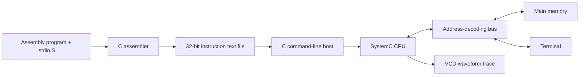

# TinyRISC

**A 32-bit CPU simulator with memory-mapped terminal I/O, a custom assembler, and an assembly standard library.**

TinyRISC connects low-level software to a simulated hardware datapath: assembly programs are translated into machine instructions, loaded into memory, and executed by a modular SystemC CPU. A bus routes memory accesses to RAM or a terminal device, allowing programs to print strings and read input using ordinary load/store instructions.

Built with **C, C++14, SystemC, assembly, and GNU Make**, the project explores processor design, instruction encoding, peripheral integration, and performance tradeoffs across hardware and software.

## Highlights

- **Modular CPU:** control unit, ALU, register file, program counter, memory, and multiplexers connected through SystemC signals.
- **Memory-mapped I/O:** address decoding routes accesses to a terminal at `0xFFFFFFFF`, with configurable latency and ready/completion signaling.
- **Instruction extensions:** `jal` stores a return address and performs a relative jump; `li` loads an immediate value into a register.
- **Assembler and library support:** label resolution, relative branches, and source-file concatenation enable reusable assembly routines.
- **Assembly I/O library:** `print`, `read`, and `print_optimized` operate on null-terminated strings.
- **Simulation tooling:** a C command-line interface configures the C++ simulation, exports terminal output, reports counters, and optionally records VCD waveforms.

## My contribution

My work focused on extending and integrating the CPU: implementing terminal input/output, designing the bus and its signal routing, adding CPU support for `jal` and `li`, and connecting the SystemC simulation to the C host program.

This was a team project developed on top of an existing TinyRISC CPU and assembler baseline. Other team members focused on assembler labels, function calls, library integration, the host program, and the assembly I/O library. Terminal and library integration also involved shared work.

## Architecture



Programs start at `0x00001000`. Main memory is byte-addressed and stores words in little-endian order. The terminal consumes the low byte of each write; a null byte marks the end of an output string. Input is buffered one line at a time and supplied as a null-terminated sequence.

The CPU uses a compact, custom instruction set inspired by RISC-V. It is not binary-compatible with standard RISC-V toolchains. Supported mnemonics are `ld`, `sd`, `not`, `and`, `or`, `add`, `sub`, `inc`, `srl`, `j`, `beq`, `bne`, `blt`, `bgt`, `jal`, and `li`.

## Build and run

Requirements: a C compiler, a C++14 compiler, Make, and a SystemC installation built for the same platform and compatible C++ configuration. `SYSTEMC_HOME` must contain `include/` and `lib/`.

```sh
export SYSTEMC_HOME=/path/to/systemc
make

./assembler test/test_print_simple.S libs/stdio.S
./project --cycles 10000 a.out
```

The terminal section prints `CPU!`. The assembler writes `a.out` by default; despite the extension, this is a text file containing one 32-bit binary instruction per line. Use `-o filename.out` to select another output file. Pass the main source first, followed by any library sources.

If the dynamic loader cannot find SystemC, add `$SYSTEMC_HOME/lib` to `LD_LIBRARY_PATH` on Linux or `DYLD_LIBRARY_PATH` on macOS.

Additional examples:

```sh
# Capture terminal output and record waveforms in trace.vcd.
./project --cycles 10000 --terminal-file terminal.txt --tf trace a.out

# Read a line from the user and print it back.
./assembler test/test_read_print.S libs/stdio.S
./project --cycles 100000 a.out
```

| Simulator option | Purpose | Default |
| --- | --- | --- |
| `-c`, `--cycles` | Simulation cycle budget | `10000` |
| `-l`, `--latency` | Terminal access latency in clock cycles | `100` |
| `-t`, `--terminal-file` | Save terminal text to a file | Standard output |
| `-f`, `--tf` | VCD trace file prefix | Disabled |
| `-h`, `--help` | Show usage | — |

Simulation runs for the requested cycle budget; there is no halt instruction. The reported cycle count is the simulation duration, not an automatically detected program completion time.

## Assembly library

Pass the string or destination address in `x1`, call with `jal x31, function_name`, and return through `j x31`.

```asm
# Store "A" and its null terminator at address 100.
li x1, 100
li x10, 65
sd x10, x1
jal x31, print
```

A word store of `65` writes `0x41 0x00 0x00 0x00`, so the string is null-terminated. `print` and `read` use scratch registers `x5`–`x7`; `print` also uses `x28`. `print_optimized` additionally uses `x27`–`x30`. Callers must preserve any values they need across calls. There is no automatic stack management or register preservation, and `read` does not accept a buffer-length limit.

## Performance exploration

The optimized print routine loads four characters per word, then extracts individual bytes with shifts and masks. This reduces data loads but introduces additional instructions.

Recorded measurements from the original implementation:

| String length | `print` loads | Optimized loads | `print` cycles | Optimized cycles |
| ---: | ---: | ---: | ---: | ---: |
| 16 | 17 | 5 | 23,046 | 22,312 |
| 64 | 65 | 17 | 87,508 | 79,644 |
| 256 | 257 | 65 | 345,364 | 312,972 |
| 1,024 | 1,025 | 257 | 1,376,788 | 1,246,284 |

For 1,024 characters, data loads fell by approximately **75%**, while cycles fell by approximately **9.5%**. The smaller runtime improvement illustrates the cost of extra instruction fetches, shifts, masks, and terminal writes. These are historical measurements, not results of an automated benchmark in this repository; the original measurement configuration is not fully recorded.

## Repository guide

| Path | Contents |
| --- | --- |
| `include/risc/` | SystemC CPU, memory, bus, and terminal modules |
| `src/risc/` | C command-line host and C++ simulation bridge |
| `include/assembler/`, `src/assembler/` | Assembler interface, parser, and instruction encoding |
| `libs/stdio.S` | String input/output routines |
| `test/` | Assembly examples for instructions, I/O, edge cases, and performance exploration |
| `build.sh` | Build and simple terminal demonstration (`sh build.sh`) |

The assembly examples are manual test programs, not an automated assertion suite. `test_terminal_instruction_fetch.S` describes an experiment that requires changing the terminal mapping and initial program counter; it is not a default-configuration smoke test.
